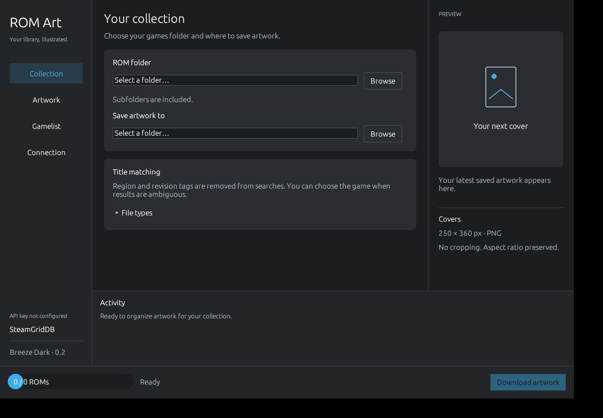

# Miyoo ROMScrapper

Desktop app that downloads ROM artwork from [SteamGridDB](https://www.steamgriddb.com/) and creates game lists for OnionOS and EmulationStation.



## Features

- Process multiple system folders, with separate artwork output paths and arcade identification for MAME/FBNeo.
- Search SteamGridDB, review matches and artwork in the gallery, or choose a local image. Unmatched ROMs are skipped and counted.
- Use Turbo mode to accept the first game match and top artwork automatically. Choose 1–8 concurrent workers.
- Save named device profiles with system IDs and artwork settings; OnionOS system folders can be detected automatically.
- Preview and bulk-import local artwork, with explicit choices when several images match a ROM.
- Limit a run to ROMs without artwork or to new/changed ROMs. Preview orphan artwork files without deleting them.
- Export EmulationStation `gamelist.xml`, OnionOS `miyoogamelist.xml`, or both. Existing entries and metadata are preserved.
- Back up files before replacing artwork or game lists. ROM files are never changed.

## Quick start

Run from the source with `cargo run --locked`, or download the latest [GitHub release](https://github.com/cirovisk/miyoo-romscrapper/releases).

1. In **Collection**, add each system folder. Set an output folder if needed, and enable **Arcade** for MAME/FBNeo. Turn on **Only process ROMs without artwork** to skip existing images.
2. In **Connection**, enter a [SteamGridDB API key](https://www.steamgriddb.com/profile/preferences/api). It stays in memory unless you enable secure saving to the system credential wallet. You can also set `STEAMGRIDDB_API_KEY`.
3. In **Artwork**, select an image type and output options. Turn on gallery review to choose among images; turn on Turbo for automatic matching and downloading.
4. In **Gamelist**, select the format or disable list generation, then start the download. Turn off automatic first-result selection to review game matches. You can also skip a ROM or choose a local image.

List generation works without an API key or internet access. For arcade ROMs, place MAME XML or DAT catalogs beside the ROMs; the app can also use existing game lists and saved aliases. Manual arcade matches are stored in `.rom-art-arcade-aliases.json`.

## OnionOS settings

Artwork presets use these canvas sizes and preserve image proportions without cropping:

| Preset | Size |
|---|---:|
| Portrait | 250 × 360 |
| Square | 250 × 250 |
| Landscape | 250 × 180 |

Enable **Use OnionOS folders and filenames** in **Collection** to save `Game.zip` artwork as `<ROM folder>/Imgs/Game.png`. Otherwise, the selected output folder is used and the extension is retained (`Game.zip.png`). Add system folders one at a time to set independent output paths. Common ROM extensions are prefilled, including `.rvz`, `.chd`, `.cue`, `.iso`, `.pbp`, `.zip` and `.7z`.

OnionOS game lists are saved in the ROM folder and link artwork under `Imgs/`. Existing ROMs and list entries without artwork remain in the list; entries are not automatically removed. After exporting, refresh the game list on the Miyoo with **Games → SELECT → Refresh all roms**.

## Files and backups

**Replace existing artwork** is off by default; **Back up replaced files** is on. Backups use unique names beside the replaced files. The same options apply to game lists. Duplicate output filenames and malformed game lists stop the operation to protect existing data.

## Build and checks

Install Rust stable and the platform build dependencies, then build with:

```sh
cargo build --release --locked
```

Linux releases include AppImages for `x86_64` and `aarch64`, built with a glibc 2.36 baseline. Windows releases include a standalone `.exe`. Manual Linux builds need a C compiler, `pkg-config`, and X11/Wayland/Secret Service development libraries; Windows builds need the MSVC toolchain and Visual Studio C++ build tools.

Run the project checks with:

```sh
cargo fmt --check
cargo test --locked
cargo clippy --locked --all-targets -- -D warnings
```

## References

- [OnionOS FAQ and emulator documentation](https://onionui.github.io/docs/faq)
- [SteamGridDB API](https://www.steamgriddb.com/api/v2)
- [EmulationStation game list format](https://github.com/Aloshi/EmulationStation/blob/master/GAMELISTS.md)
- [Historical Skraper analysis](docs/skraper-analysis.md)
