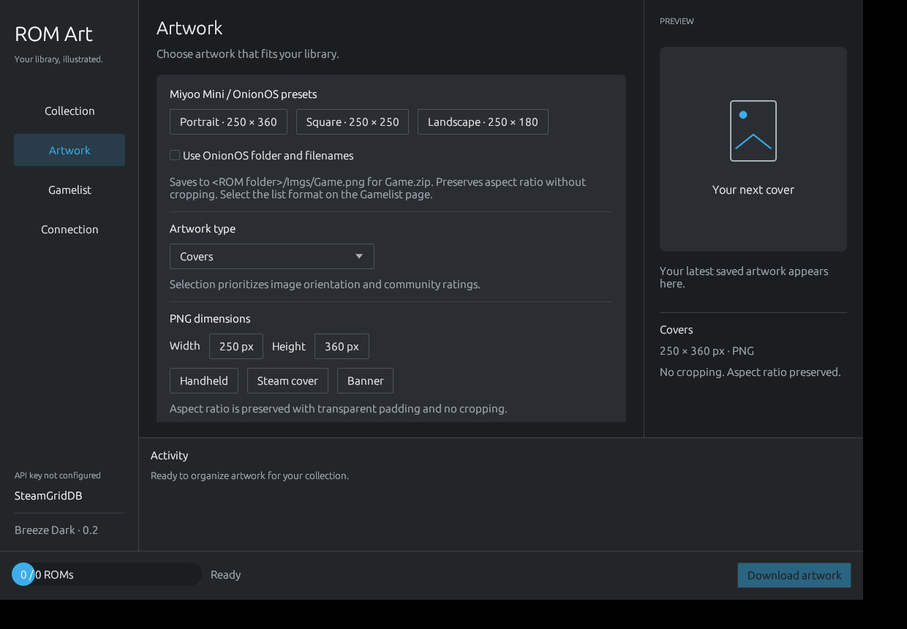

# Miyoo ROMScrapper

Rust desktop app for downloading ROM artwork from **SteamGridDB** and exporting game lists for **OnionOS / Miyoo Mini** and **EmulationStation**. The interface uses English by default and a KDE Breeze Dark inspired theme.


## Run

```fish
cargo run --locked
```

The app uses `eframe/egui` and the desktop portal file picker through `rfd`. It is not a Qt application and does not follow the Plasma global theme automatically.

## Getting started

1. In **Collection**, select a single system's ROM folder and an artwork output folder.
2. In **Connection**, paste your personal [SteamGridDB API key](https://www.steamgriddb.com/profile/preferences/api). You can also provide it using `STEAMGRIDDB_API_KEY`. By default the key stays in memory only. To keep it between sessions, enable **Remember this key securely** and click **Save key securely**; it is stored in the system credential wallet (KWallet on KDE), not in app settings, cache or logs.
3. In **Artwork**, choose one of SteamGridDB's artwork types: covers, banners/heroes, logos or icons. Choose output dimensions and naming options.
4. In **Gamelist**, choose the export format and whether to generate lists after downloading.
5. Click **Download artwork**. By default, the first SteamGridDB game result is selected; turn that option off to review results. In the review dialog, mark **Arcade ROM (MAME / FBNeo)** for short arcade filenames. The app checks `.dat` and `.xml` catalogs beside the ROMs, then existing `gamelist.xml` / `miyoogamelist.xml` names, then saved aliases. If none match, edit the search or select a result manually; the selected title is saved in `.rom-art-arcade-aliases.json` by ROM-relative path. Optionally enable **Choose artwork from a gallery** to preview and select an image after matching a game. The review dialog also lets you skip or choose a local image.

On **Collection**, enable **Only process ROMs without artwork in the destination** to skip ROMs whose target PNG already exists. When game list generation is enabled, exported lists still include the full ROM folder.

The API key is needed for downloads. **Generate lists locally** works without an API key or internet access. Window preferences last for the current session. If the wallet is locked or unavailable, the app reports the credential-store error and the key can still be entered for that session.

## OnionOS / Miyoo Mini presets

The **Artwork** page provides:

| Preset | PNG dimensions |
|---|---|
| Portrait | 250 × 360 |
| Square | 250 × 250 |
| Landscape | 250 × 180 |

These presets enable **Use OnionOS folder and filenames**: `Game.zip` produces `<ROM folder>/Imgs/Game.png`. Letter case, region tags and subfolders are retained in artwork filenames. The image fits within a transparent canvas with its aspect ratio preserved and no cropping. The square and landscape layouts are convenience presets within the same 250 × 360 area.



Select one system folder such as `Roms/GBA`, rather than the entire `Roms` directory. The `Imgs` output folder follows the ROM folder automatically. Changing a filename convention does not rename or remove existing artwork. If two ROMs would produce the same image filename, including case-only collisions on FAT cards, the operation stops before downloading or exporting.

With OnionOS naming disabled, the selected output folder is used and ROM extensions remain in image names: `Game.zip` produces `Game.zip.png`. This supports the original naming convention.

## Game lists

Choose a format on the **Gamelist** page:

- **gamelist.xml**: full EmulationStation list; preserves custom names, descriptions, statistics, folders and other metadata.
- **miyoogamelist.xml**: compact OnionOS list with `path`, `name` and `image`. Existing custom names and game entries are retained. Missing artwork links to a real transparent PNG at `Imgs/.rom-art-placeholder.png`.
- **gamelist.xml + miyoogamelist.xml**: maintain both; recommended when keeping full metadata alongside an OnionOS export.

The first OnionOS export uses an existing `gamelist.xml` as its source when available; subsequent updates preserve names customized in `miyoogamelist.xml`. OnionOS exports intentionally omit metadata that MainUI does not use. Choose both formats to keep full metadata in the standard list. Backups preserve previous versions when enabled.

Example OnionOS entry:

```xml
<gameList><game><path>./Game.gba</path><name>Game</name><image>./Imgs/Game.png</image></game></gameList>
```

Each list is saved in the selected ROM folder. OnionOS exports require artwork inside that folder so paths stay portable to the SD card. ROMs without artwork and old entries are retained; entries are never removed automatically. Standard lists can use absolute image paths outside the ROM folder. No descriptions, genres or release dates are invented.

After exporting, use **Games → SELECT → Refresh all roms** on the Miyoo. OnionOS displays games from subfolders as a flat list when using a miyoogamelist. The app does not edit emulator configurations or cache databases. Close any frontend that may write the same XML files while updating them.

## Preservation and backups

**Replace existing artwork** is off by default. **Back up replaced files** is on by default and applies to both artwork and game lists. Copies use unique names alongside the originals, such as `Game.png.backup-ABC123.png` or `miyoogamelist.xml.backup-ABC123.xml`. Turn this option off to replace files without backups. Unchanged lists and artwork that is kept do not create backups.

Writes are atomic per file. Malformed XML and duplicate game paths are rejected. Existing ROMs are never modified. If a download stops before completion, already saved images remain available; use **Generate lists locally** to rebuild the lists afterward.

## Matching and limits

SteamGridDB searches use filenames with recognized trailing region, language, revision and disc tags removed. Unknown hack tags and subtitles are retained. The first search result is selected by default; disable automatic selection to review each game's results and mark arcade ROMs. Arcade catalogs can use MAME XML (`machine name` / `description`) and DAT (`game` / `machine` name / `description`) formats and must be placed directly in the selected system folder. ZIP archives are matched by their external name without extraction or hash calculation. A local image can be selected if the game or its chosen artwork type is missing from SteamGridDB. The optional artwork gallery shows available images with a small preview, dimensions and score; previews larger than 4 MiB are omitted, but those images can still be selected.

Artwork selection requests static PNG/JPEG/WebP images and prefers matching orientation, then community score, from the first page of results when the gallery is off. Local images are converted to PNG and fit to the chosen dimensions without cropping. Not all games, hacks or translations have matching artwork in the catalog.

Requests are sequential with a 30-second timeout. Authentication, quota or server errors stop the batch. Downloaded image bytes are temporarily cached in the artwork folder's `.rom-art-cache` during an operation and removed when it ends, including cancellation and errors. The API key is sent only to API requests, never to artwork URLs. HTTP redirects are refused. Secure persistence uses the operating system's credential store: Secret Service on Linux, Keychain on macOS, and Windows Credential Manager on Windows.

## Development and verification

```fish
cargo fmt --check
cargo test --locked
cargo clippy --locked --all-targets -- -D warnings
cargo build --locked
```

Tests cover title matching, manual review, API authentication isolation, cache reuse, PNG output, OnionOS naming, filename collisions, both XML formats, placeholders, metadata preservation, backups and idempotent reruns. HTTP tests use a local mock server. Real SteamGridDB account authentication, the KDE portal picker and physical-device behavior have not been verified.

## References

- [OnionOS FAQ: miyoogamelist and ROM refresh](https://onionui.github.io/docs/faq).
- [OnionOS emulator and subfolder conventions](https://onionui.github.io/docs/emulators).
- [Official OnionOS conversion script](https://github.com/OnionUI/Onion/blob/main/files/20230617/New-MiyooGameListXml.ps1).
- [SteamGridDB API](https://www.steamgriddb.com/api/v2) and [official client](https://github.com/SteamGridDB/node-steamgriddb).
- [EmulationStation game list format](https://github.com/Aloshi/EmulationStation/blob/master/GAMELISTS.md).
- [Historical Skraper analysis](docs/analise-skraper.md).
